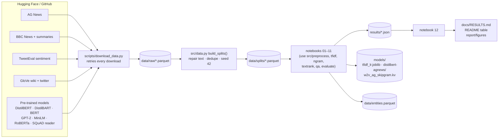
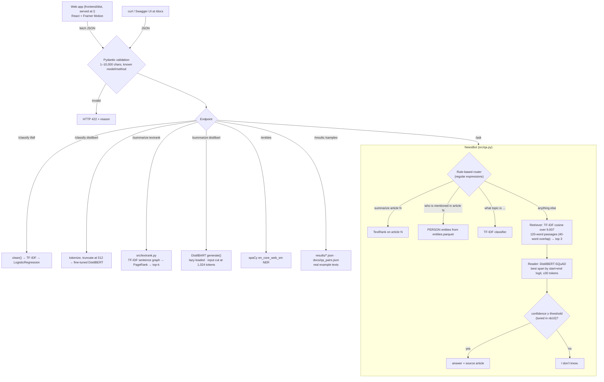

# NewsMind architecture

## 1. Data → experiments → results

Rule: every number in the docs comes from `results/*.json`. nb12 is the only place that turns them into
tables, and it refuses to run if any result was produced in FAST mode.

## 2. The API at run time

Start-up (FastAPI `lifespan`) loads TF-IDF+LR, DistilBERT, spaCy and NewsBot once, then runs one warm-up
prediction per classifier so the first real request is not slow. DistilBART (1.2 GB) loads on its first request.
The built web app is mounted at `/` *after* all API routes, so it can never shadow an endpoint.

## 3. The web app (`frontend/`)

One page with five views, each calling one endpoint. Every model result is drawn onto the text itself with
an animated highlighter mark (`components/ui.jsx:Marker`, a background gradient whose width grows 0 → 100%).

| View | Endpoint | What it shows |
|---|---|---|
| Topic | `POST /classify` | label, class probabilities as animated bars; "Compare both" runs TF-IDF and DistilBERT side by side |
| Summary | `POST /summarize` | TextRank: the whole article, kept sentences marked in rank order, PageRank score per sentence. DistilBART: generated text revealed word by word |
| Names and places | `POST /entities` | entities marked in the text by kind; the legend filters one kind |
| Ask the archive | `POST /ask` | chat; answer marked inside its source passage; confidence bar with the tuned "I don't know" threshold |
| How good is it? | `GET /results` | dot plot of classifier accuracy, bars for ROUGE, QA and tweet results, all read from `results/*.json` |

Build: `esbuild` bundles `src/main.jsx` (JSX, CSS, fonts) into `dist/` (`frontend/build.mjs`). Fonts are bundled,
so the app needs no internet. Motion respects the operating system's "reduce motion" setting.

## 4. Modules

| File | Role | From scratch? | Tested in |
|---|---|---|---|
| `src/utils.py` | paths, cache folders, seed, device (CUDA > MPS > CPU), timer, FAST flag | – | used everywhere |
| `src/data.py` | download → splits; AG/BBC/tweet text repair; dedup | – | `tests/test_splits.py` |
| `src/preprocess.py` | `clean(text, mode="news" \| "tweet")` and each step on its own | yes (uses NLTK pieces) | `tests/test_preprocess.py` |
| `src/tfidf.py` | BoW and TF-IDF, identical to sklearn's defaults | **yes** | `tests/test_tfidf.py` (allclose vs sklearn) |
| `src/ngram.py` | n-gram LM: MLE / Laplace / add-k, `<UNK>`, perplexity, generation | **yes** | `tests/test_ngram.py` (hand-computed probabilities) |
| `src/textrank.py` | TextRank + PageRank power iteration | **yes** | `tests/test_textrank.py` (PageRank vs networkx) |
| `src/qa.py` | chunking, retriever, reader, NewsBot, router | retriever uses our TF-IDF | `tests/test_qa.py` |
| `src/evaluate.py` | accuracy, macro P/R/F1, confusion matrix, SQuAD EM/F1, results JSON | metrics via sklearn, EM/F1 ours | `tests/test_qa.py` |
| `api/app.py` | FastAPI service, also serves the web app | – | `tests/test_api.py` |
| `frontend/src/` | React web app (App.jsx, one component per view, ui.jsx shared pieces) | – | checked in a browser (see README) |
